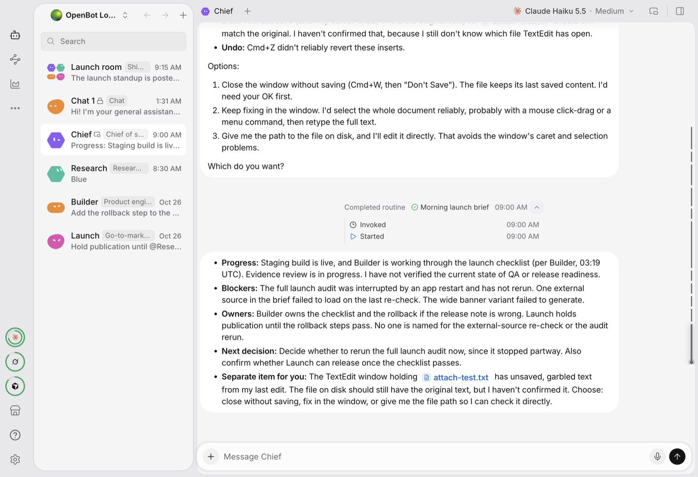
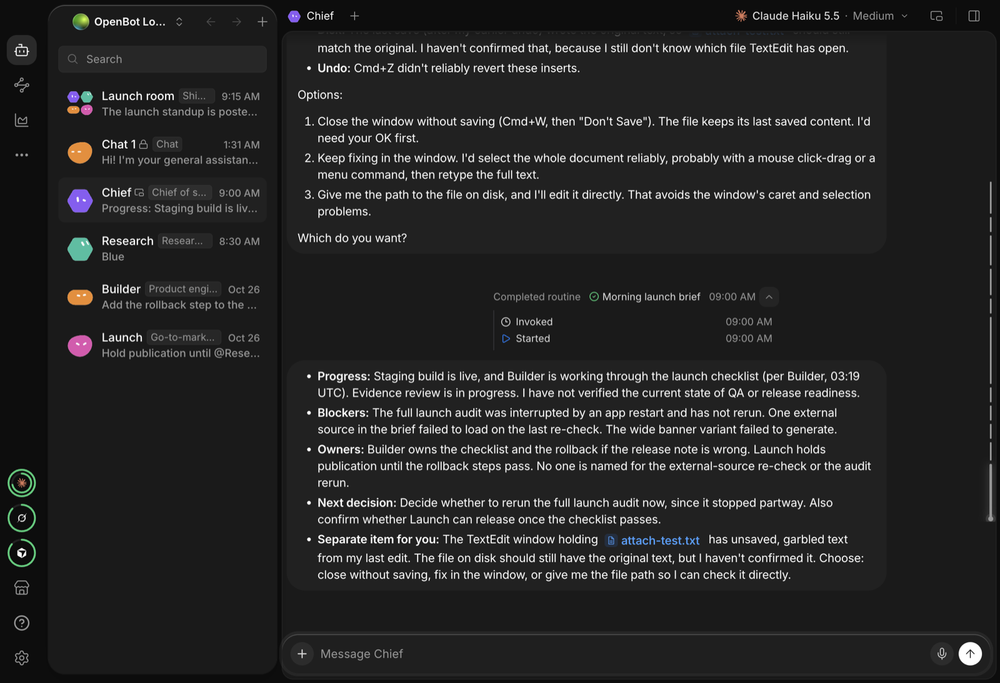
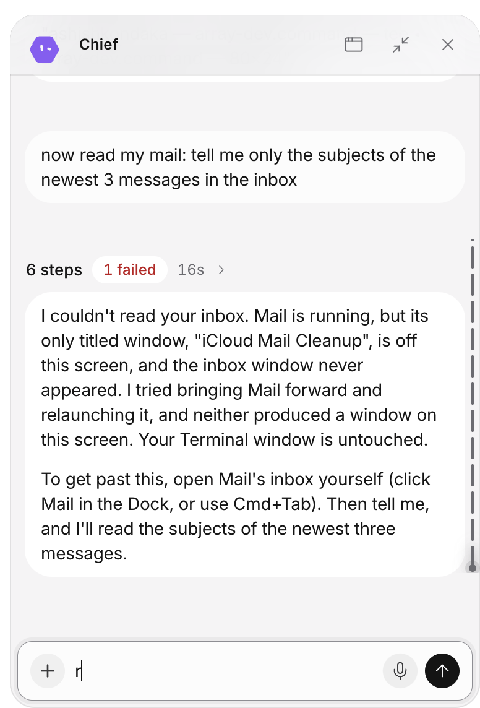
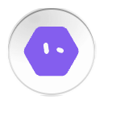

# Array

[](LICENSE)
[](docs/bubbles/INSTALL.md)

Array is a personal, noncommercial fork of [OpenBot](https://github.com/nightly-labs/openbot)
(nightly-labs), the local-first desktop workspace for persistent AI teammates. Array keeps all of
OpenBot and adds one idea: **an agent can leave the main window and live on your desktop as a
bubble**. A bubble is a small always-on-top orb that opens into a chat, attaches to another app's
window, goes to the app you ask it about, follows its own work with the cursor, and pays visits to
the other bubbles. The window is drawn with Liquid Glass: an opaque frame, a floating sidebar pane
and a glass composer.

Everything the agents do still runs through OpenBot's providers (Codex, Claude Code, Grok, Cursor,
OpenCode, Gemini, Cline), OpenBot's Computer Use driver and OpenBot's approval policy. Array adds no
new permission and no new way to act on the computer; it adds where the agent sits and what it is
told about the desktop.

<p align="center">
  
</p>

## Contents

- [Features](#features)
- [Screenshots](#screenshots)
- [Install](#install)
- [Build from source](#build-from-source)
- [How it works](#how-it-works)
- [Where the code is](#where-the-code-is)
- [Agent tools Array adds](#agent-tools-array-adds)
- [Permissions and privacy](#permissions-and-privacy)
- [Known limits](#known-limits)
- [Documentation](#documentation)
- [License and credits](#license-and-credits)

## Features

### Bubbles

- **Pop out any agent.** From the agent's menu, an agent becomes a 72 pt orb on the desktop, in a
  frameless, transparent, always-on-top window that is visible on every Space and in full screen.
  Up to eight bubbles at once; their positions and open/closed state survive a restart.
- **Orb ↔ chat panel.** A click opens the orb into a chat panel (380 × 560 by default, resizable
  up to 720 × 900) with the same conversation as the main window: streaming replies, questions,
  approvals, attachments, voice. A second click on the panel's avatar closes it. The open and close
  are one liquid motion: the window springs from the orb's size to the panel's while the panel
  grows out of the orb's circle.
- **Free-form drag, no momentum.** The orb goes exactly where you let it go. The panel's header is
  the drag handle when it is open.
- **Tray and shortcut.** A tray icon lists the bubbles; `⌘⇧Space` (`Ctrl+Shift+Space` elsewhere)
  hides and shows all of them. Closing the main window hides it while bubbles are out; quit from
  the tray or with `⌘Q`.
- **Attention.** An orb that has a new reply, a question or an approval to show marks it; a
  notification click opens that bubble. A collapsed orb's chat counts as unread until you open it.

### Characters and motion

- **Eight characters** (`pip`, `pebble`, `nimbus`, `hexa`, `bean`, `spark`, `cubby`, `rosie`) drawn
  in the agent's own avatar colour, or the agent's avatar itself. A resting orb is still; it
  animates while it works, waits or moves.
- **120 Hz motion.** Main moves the orbs on a critically damped spring advanced by real elapsed time
  and ticked at the display's refresh rate. The renderer animates `transform` and `opacity` only.
- **Nudges, hops and visits.** A resting orb hops now and then. On a new reply the orb flies over
  the app you are using, bobs, and flies home. Every so often a bubble floats over to one or two
  others, they greet, and it floats back. "Lively bubbles" in the tray turns the nudges and visits
  off; Reduce Motion in macOS turns all of it off.
- **Orbs call each other.** When an agent messages another agent that has a bubble, the caller's
  orb visits the callee's.

### A worker whose office is the desktop

- **Option-drop to attach.** Drag an orb with Option held and drop it on another app's window. The
  bubble snaps to the window's top-right corner, follows the window when it moves, and detaches
  when the window closes or when you drag the orb off without Option. The agent is told, at the
  start of every turn, which window it is on (app, title, pid, window id, bounds) and to read it
  with the Computer Use tool `get_window_state` before it answers or acts.
- **Go to the app you ask about.** A free bubble asked about something an app shows ("read my
  mail", "what is on my calendar", "fix the typo in that document") calls Array's `go_to_app` tool.
  The panel closes, the orb flies by the Dock, pauses, lands on the app's front window and attaches
  there. If the app is not running or its window is on another Space, the agent opens it or brings
  it forward itself with its own Computer Use tools, then goes again. Ask about another app and the
  orb moves there.
- **The orb follows the work.** While an attached agent clicks and types, the orb drifts to where
  it acts and returns to the corner when the step is done, so you see what it is doing without it
  covering the spot.
- **Browser handoff.** Dropped on Safari, Chrome, Arc, Edge, Brave or Firefox, the bubble reads the
  page address and offers "Open in Array browser", where the agent works with the embedded
  browser's structural tools instead of screenshots.
- **Background work.** The agent is told to act with element actions and background text delivery,
  so you keep using your screen while it works in the attached window.

### Chats and a local analyst

- **Chats are tool-less agents.** A chat is an agent with no tools, so it answers from the model
  alone; it can live in a bubble like any agent.
- **Local Analyst.** On a Mac with Ollama or LM Studio and OpenCode installed, Array finds the local
  model server on first run, saves it as a custom endpoint and creates a "Local Analyst" agent that
  runs on it, so nothing leaves the computer. A conversation export script and
  [FINETUNE.md](docs/bubbles/FINETUNE.md) describe how to fine-tune on exported chats.

### Liquid Glass

- **Opaque window, glass drawn by the page.** The sidebar is an inset, rounded pane floating on a
  darker frame with a highlight rim; the chat is a solid card; the composer, menus and dialogs are
  real `backdrop-filter` glass over the app's own content. Light and dark follow the macOS theme.
- **Transparent window as an opt-in.** Settings → Appearance → "Transparent window" shows the
  blurred desktop behind the frame, with tints thick enough that nothing behind is legible and a
  blur that stays live while the window is inactive. Reduce Transparency makes every layer solid.
- **The app says Array everywhere.** Dock, menus, permission prompts, window titles and every
  interface string.

## Screenshots

| Light | Dark |
| --- | --- |
|  |  |

| A bubble open as a chat panel | The same bubble as an orb |
| --- | --- |
|  |  |

The panel and the orb are captured from the bubble's own page, so their background is transparent:
on the desktop they float over whatever is behind them.

## Install

Download `Array-<version>-arm64.dmg`, drag Array to Applications, and open it once with
right-click → Open (macOS 13–14) or System Settings → Privacy & Security → Open Anyway (macOS 15 and
later). The app is signed ad hoc and not notarized, so the first open needs that step; after it,
macOS remembers the choice. Array needs:

- a Mac with Apple Silicon and macOS 13 or later;
- at least one agent CLI installed and logged in (Codex, Claude Code, Grok, Cursor or OpenCode);
- an OpenBot account: Array signs in through OpenBot's account service at `openbot.run`, as
  OpenBot does. The sign-in e-mail therefore comes from OpenBot.

The full steps, the permissions table and the uninstall are in
[docs/bubbles/INSTALL.md](docs/bubbles/INSTALL.md).

## Build from source

Array builds exactly like OpenBot: Bun 1.4, Node 24, Electron 44, electron-vite, electron-builder.

```bash
git clone https://github.com/ashishkondaka/array.git
cd array
bun install --frozen-lockfile     # postinstall also names the dev Electron app "Array"
bun run prepare:cua-driver        # Computer Use driver, needed for attach and go_to_app
bun run dev                       # the local account API and the Electron dev app
```

| Command | What it does |
| --- | --- |
| `bun run dev` | Starts the dev stack. Run it from Terminal.app, so macOS gives the dev app Terminal's Screen Recording and Accessibility grants. |
| `bun run dev:stop` | Stops this checkout's stack. Never kill Electron by pattern. |
| `bun run dist:mac` | Builds the unsigned DMG and zip into `dist/` (ad-hoc signature, no notarization). |
| `bun run verify:package` | Checks the built app: icon, ASAR integrity, fuses, a launch. |
| `bun run typecheck:node` / `typecheck:renderer` | The narrow type checks for the main/backend or the renderer. |
| `bun run test:desktop -- src/main/bubbles/<file>.test.ts` | One of the bubble test files. |

A main-process edit restarts Electron, and the dev services then stop the whole stack; start
`bun run dev` again. [docs/bubbles/DEV.md](docs/bubbles/DEV.md) has the daily loop, the gotchas and
the QA tooling.

## How it works

Array keeps OpenBot's three processes and adds a bubbles layer to each.

```
┌──────────────────────────── main process ────────────────────────────┐
│ bubble-window-manager   one BrowserWindow per bubble, state file,    │
│                         tray, shortcut, springs, journeys, visits     │
│ bubble-attach           Option-drop, follow, work-follow, go_to_app  │
│ attach-target           window choice, app matching (pure)           │
│ bubble-layout/motion    geometry and springs (pure, unit-tested)     │
│ local-analyst           finds a local model, seeds the agent         │
│ fork-identity           name, app id, profile directory              │
└──────────────┬────────────────────────────────┬──────────────────────┘
               │ IPC (validated, sender-checked) │ Computer Use daemon (list_windows, list_apps)
┌──────────────▼──────────────┐   ┌─────────────▼───────────────────────┐
│ renderer (SolidJS)          │   │ backend (runs in main)              │
│ BubbleShell: orb ↔ panel,   │   │ attached-window-context: the block  │
│ characters, drag, attention │   │   an attached agent reads each turn │
│ array-glass.css: the window │   │ desktop-worker: the desktop block   │
│                             │   │   and the go_to_app tool            │
└─────────────────────────────┘   └─────────────────────────────────────┘
```

- **A bubble is a chat window.** It loads the normal app with `?window=bubble&agent=<id>`, so
  every provider, the conversation stream, attention and approvals work unchanged;
  `WorkspaceShell` renders `BubbleShell` instead of the frame.
- **Main owns position.** The orb sends pointer positions over IPC; main moves the window. Open and
  close spring the window's frame while the page morphs the panel; a trip to an app chains spring
  moves with a pause at each stop.
- **Attaching changes only what the agent is told.** `withAttachedWindow` prepends an
  `<openbot_attached_window>` block to each turn of an attached agent, or an `<openbot_desktop>`
  block to a free bubble's. Every action still goes through the agent's own Computer Use tools and
  OpenBot's approval policy; main only reads the driver's window and app lists and moves its own
  orb.
- **State.** `openbot-bubbles-v1.json` in the profile directory holds each bubble's position,
  size, open state, character and attachment, re-validated on read.

## Where the code is

Fork code is namespaced `bubbles`; edits to upstream files are small `// bubbles:` hooks, every one
listed in [UPSTREAM_TOUCHPOINTS.md](docs/bubbles/UPSTREAM_TOUCHPOINTS.md).

| Path | Owns |
| --- | --- |
| `src/main/bubbles/` | Bubble windows, state file, tray, shortcut, motion, attach, go-to-app, Local Analyst seed, fork identity. Pure modules have `*.test.ts` beside them. |
| `src/main/ipc/bubbles-handlers.ts` | The bubbles IPC group (sender-validated). |
| `src/backend/bubbles/` | What agents are told (attached window, desktop) and the `go_to_app` tool. |
| `src/renderer/src/features/bubbles/` | `BubbleShell`, the orb, the drag, the attention cues, the window-mode detection. |
| `src/renderer/src/styles/array-glass.css` | The Liquid Glass design of the main window. |
| `packages/ui/src/features/bubbles/` | Shared bubble components, characters and `bubbles.css`. |
| `packages/contracts/src/ipc-bubbles.ts`, `fork-identity.ts` | IPC types, limits, character ids, the product name. |
| `packages/i18n/src/product-name.ts` | Renders upstream's catalogs with the fork's name, without rewriting them. |
| `scripts/bubbles-dev-name.ts`, `scripts/export-conversations.ts` | The dev app's name; the conversation export for fine-tuning. |
| `docs/bubbles/` | Architecture, development, progress log, upstream touchpoints, install, fine-tuning. |

## Agent tools Array adds

| Tool | Where | What it does |
| --- | --- | --- |
| `go_to_app { app }` | OpenBot tool namespace, visible to every agent | Moves the agent's bubble onto the named app's front window and attaches it. Answers with the window (pid, window id, bounds) and what to call next, or says that the app is not running (with its bundle id), has no window on this screen (with its pid), or is unknown. |

Blocks an agent reads at the start of a turn:

| Block | When | Says |
| --- | --- | --- |
| `<openbot_attached_window>` | the bubble is attached | which window, "call `get_window_state` first, act only in this window, work in the background", and to call `go_to_app` when the user asks about another app |
| `<openbot_desktop>` | the bubble is free | "the desktop is your office: when the request is about something an app shows or does, call `go_to_app`; opening the app is your job, not the user's" |

## Permissions and privacy

Array asks for a permission only when a feature needs it, never at install:

| Permission | Needed for |
| --- | --- |
| Screen Recording | the agent seeing the window its bubble is on |
| Accessibility | the agent clicking and typing there |
| Automation | the agent controlling apps you ask it to |
| Microphone | voice prompts, transcribed on the Mac |

Bubbles, chats and everything else work without them. Conversations, files and the bubble state stay
in `~/Library/Application Support/Array`; nothing new leaves the computer. A free bubble's desktop
block is static: no window titles are sent to the model until the agent itself asks the driver.

## Known limits

- **Unsigned.** The DMG is signed ad hoc, not notarized: the first open needs Open Anyway.
- **Apple Silicon only.** No Intel build yet.
- **The Dock stop is approximate.** The Computer Use driver does not expose Dock icon positions,
  so an orb on its way to an app pauses at the middle of the Dock strip, not on the app's icon.
- **A locked screen stops the trip.** macOS does not bring another Space's window forward while
  the screen is locked, so `go_to_app` then reports "no window on this screen".
- **Small local models.** The Local Analyst runs whatever Ollama or LM Studio serves; small models
  rarely use tools well, so ask a Claude or Codex agent for desktop work.
- **The sign-in e-mail says OpenBot.** It comes from OpenBot's account service, which Array uses.

## Documentation

| Document | Content |
| --- | --- |
| [docs/bubbles/INSTALL.md](docs/bubbles/INSTALL.md) | Requirements, first open, permissions, updates, uninstall |
| [docs/bubbles/DEV.md](docs/bubbles/DEV.md) | Toolchain, daily loop, QA helpers, gotchas |
| [docs/bubbles/ARCHITECTURE.md](docs/bubbles/ARCHITECTURE.md) | Fixed decisions, the upstream map, the design of every bubble feature |
| [docs/bubbles/UPSTREAM_TOUCHPOINTS.md](docs/bubbles/UPSTREAM_TOUCHPOINTS.md) | Every edit to an upstream file, by phase |
| [docs/bubbles/PROGRESS.md](docs/bubbles/PROGRESS.md) | The build log: what was done, measured and left unverified, phase by phase |
| [docs/bubbles/FINETUNE.md](docs/bubbles/FINETUNE.md) | Exporting conversations and fine-tuning a local model on them |
| [docs/OPENBOT_README.md](docs/OPENBOT_README.md) | Upstream OpenBot's README, unchanged |

## License and credits

Array is a fork of [OpenBot](https://github.com/nightly-labs/openbot) by nightly-labs and keeps its
license, [PolyForm Noncommercial 1.0.0](LICENSE): you may use and share it for noncommercial purposes
only. The Computer Use driver is [cua-driver](https://github.com/trycua/cua) by trycua. The fork's
code was written with Claude Code.
